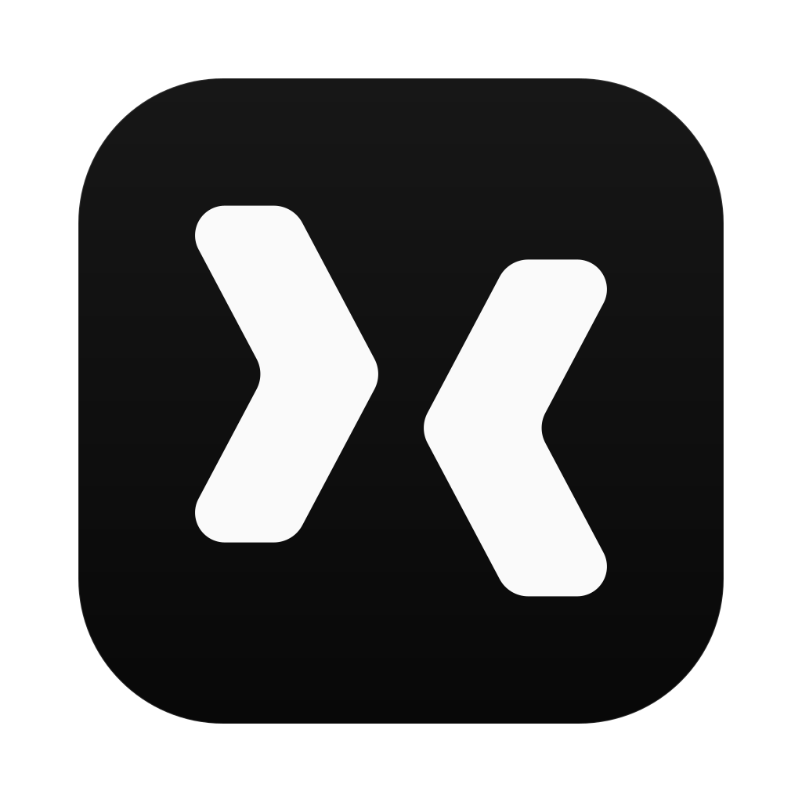

<div align="center">



# Mera

**An agent-native workbench for creative projects**
**Materials, notes, recipes and dynamic workflows on one canvas, in a single Rust + React workspace.**

[](LICENSE)
[](https://www.rust-lang.org)
[](https://bun.sh)
[](https://tauri.app)

</div>

Creative projects sprawl: reference material in one place, tools and scripts in
another, outputs in a folder, decisions in a chat log. Mera keeps the whole
project in one place. Each project is an infinite canvas holding source
materials, notes, collections, recipes and dynamic workflow runs, driven by
humans and agents through one operation pipeline and extensible out-of-process
mods (`mod-sdk`).

The goal is an agent as the main way to work: you describe what you want, and
it gathers and organizes material, composes operations and recipes, runs them
and iterates with you. Today agents reach that path through the operator adapter
`mera-agent-adapter`, which serves the workspace operation table as MCP tools
over a token-guarded loopback connection; the desktop app can start it in
development from `MERA_MCP_PORT` and `MERA_MCP_TOKEN`. An ACP client that hosts
an agent such as Tarz is still pending. Until then MCP clients can use the same
operations, and the human path is complete without either.

## Architecture

### One operation pipeline for humans and the agent

Humans and the agent operate the same pipeline in `mera-app-host`. Canvas
edits go through `BoardCommand` and operation invocations go through
`OperationService`; changes can be previewed, undone and redone, and every
change records who made it (`CommandActor`). The agent is a peer operator that
shares the user's domain model and operation paths - not a chatbot bolted onto
an editor, and not an external tool that only sees an API.

Today humans drive the pipeline through the desktop app, while agents can reach
the same operations through `mera-agent-adapter`'s development MCP
connection. Editing, saving and undo/redo work fully without an agent.

### Project, Board and Mods

A **Project** is the top-level container. Its **Board** is the persisted canvas
document; board items reference assets, collections, recipes, dynamic workflow
runs, or hold notes. External capabilities are supplied by sandboxed
out-of-process **Mods** over JSON-RPC (`mod-sdk`).

### Desktop app

The engine runs as a **desktop app** with the canvas editor (`src-tauri`).

## Stack

| Layer             | Technology               |
| ----------------- | ------------------------ |
| Domain / host     | Rust 2024 workspace      |
| Desktop host      | Tauri 2                  |
| Extensibility     | Sandboxed mods (`mod-sdk`) |
| UI                | React 19 + Vite 7 (Bun)  |

## Requirements

- Rust MSRV **1.96**
- Bun
- Platform prerequisites for **Tauri 2** (see the Tauri docs for your OS)

## Quick start

```bash
# Desktop host (Vite HMR + Tauri window)
cd ui && bun install && cd ..
cd src-tauri && cargo tauri dev

# Frontend build only
cd ui && bun run build
```

## Workspace layout

All 9 active Cargo workspace members are listed here; `Cargo.toml` `[workspace]`
is the authority. Legacy AIGC, Burn, worker, and static-workflow crates are
consolidated in `crates/aigc/` as a read-only source archive excluded from the
workspace.

```text
src-tauri/                mera - Tauri 2 desktop shell, thin IPC layer
crates/core/              mera-core - project, board, collections, workflow/command models, history, events
crates/config/            mera-config - workspace config, path layout, storage budget config
crates/mod-sdk/           mod-sdk - mod manifest, interface, JSON-RPC protocol, SDK, registry, process host, conformance kit
crates/sandbox/           mera-sandbox - cross-platform OS sandbox drivers, resource limits, and process-group runner
mods/text/                text-mod - first-party text mod: six deterministic document operations over the mod protocol
crates/app-host/          mera-app-host - WorkspaceHost, Project/Board/Library/Collection/Recipe/DynamicWorkflow/ModManager/StorageBudget services
crates/agent-adapter/     mera-agent-adapter - operator adapter: projects the operation table as an MCP tool server
crates/package-installer/ mera-package-installer - shared TUF Ed25519 verification, safe archive extraction, atomic staging/promote
crates/aigc/              sealed read-only archive of 10 AIGC/worker/runtime crates (excluded from workspace)
ui/                       React 19 + Vite 7 frontend, Bun-managed
assets/                   brand icons and static assets
```

`src-tauri/` is the thin desktop host adapter driving the `mera-app-host`
facade; domain logic lives under `crates/`, and the first-party text mod lives
under `mods/text/`.

No workspace crate depends on an agent stack. The open-source agent kernel
lives in the sibling repository `../agent-stack-oss` (`Causa`: `causa`,
`causa-kernel`, `causa-protocol`, `causa-runtime`, `causa-provider`,
`causa-extension`). Agents reach the operation pipeline through
`mera-agent-adapter` above `mera-app-host`: it serves the operation table as an
MCP server, does not depend on Causa, and only `src-tauri` depends on it.

## Conventions

Repository conventions - enforced layering, module layout, commit titles,
generated catalogs, dependency policy - are in [AGENTS.md](AGENTS.md)
`Conventions`. Do not keep a second copy here.

## Local data

Generated build outputs, runtime workspaces, local configuration, and private
planning notes are intentionally ignored by git. Put local runtime files under a
workspace base path (for example `--base-path ./workspace`) rather than
committing them.

See [AGENTS.md](AGENTS.md) for the full workspace map and agent conventions.

## Status

Mera is in active development; internal APIs and document schemas will still
change. Where it stands today:

- The Project, Board, Library, Collection, Recipe, Dynamic Workflow, Storage
  Budget, and Mod Manager systems are implemented in Rust with a React three-pane
  workbench UI.
- First-party and third-party capabilities run as sandboxed out-of-process mods
  via `mod-sdk`; legacy AIGC/Burn crates are sealed in `crates/aigc/` pending
  future AIGC mod isolation.
- `mera-agent-adapter` serves the operation table as MCP tools over a loopback
  connection; the desktop app starts it in development from `MERA_MCP_PORT` and
  `MERA_MCP_TOKEN`. The ACP client that hosts an agent, and the in-app agent
  panel, are pending.

## License

Mera is licensed under **GPL-3.0-or-later**. See [LICENSE](LICENSE).
Opening a pull request is assumed to signal agreement with these
licensing terms.
